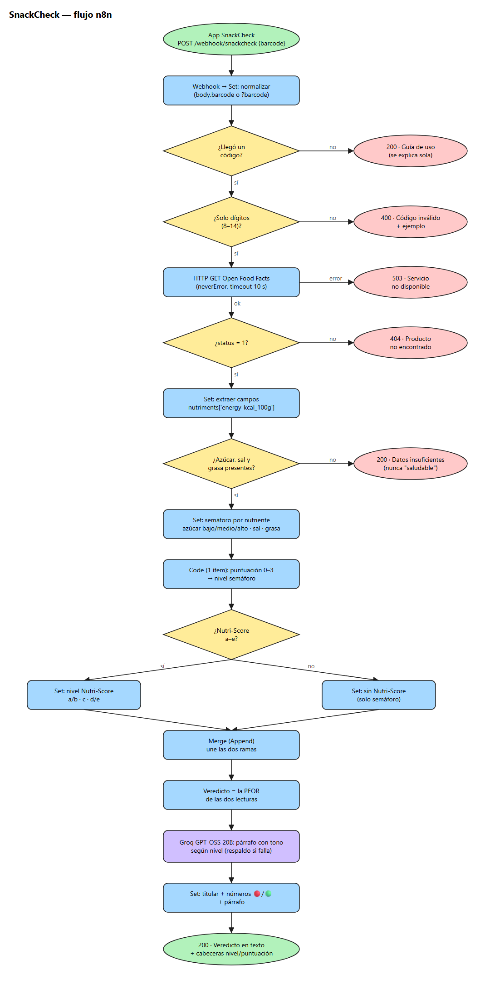

# SnackCheck — ¿Es saludable este snack?

Automatización de n8n que recibe el código de barras de un alimento envasado, busca su información nutricional real en **Open Food Facts** y devuelve un veredicto corto y humano: un titular, los números clave con marcador 🔴/🟢 y un párrafo amigable escrito por IA (Groq).



## Contenido de la entrega

| Archivo | Qué es |
|---|---|
| `snackcheck-workflow.json` | Flujo exportado de n8n (sin credenciales) |
| `diagrama/snackcheck.excalidraw` | Diagrama de diseño (abrir en [excalidraw.com](https://excalidraw.com) → Open) |
| `diagrama/snackcheck.png` / `.svg` | El mismo diagrama como imagen |
| `README.md` | Este documento |
| `PRUEBAS.md` | Registro de pruebas (TC-001 … TC-014) |
| `CHANGELOG.md` | Historial de versiones (SemVer) |

## Propósito

El fundador de SnackCheck quiere que su app, al escanear un producto, muestre en segundos si es una buena elección para el día a día o un gusto ocasional. Esta automatización es el motor: datos reales (no inventados), reglas de clasificación fijas y explicables, y un texto con el tono de un amigo que sabe del tema.

## Cómo funciona

1. **Webhook - Recibir código de barras**: `POST /webhook/snackcheck`. Responde desde nodos *Respond to Webhook*.
2. **Set - Normalizar entrada**: toma `body.barcode` (o `?barcode=` en la URL) y lo deja como texto sin espacios.
3. **IF - ¿Llegó un código?**: si no llegó, responde una guía de uso (200). Nunca un error en blanco.
4. **IF - ¿Es un número válido?**: solo dígitos, entre 8 y 14 (EAN-8, UPC-A, EAN-13, GTIN-14). Si no, 400 con un ejemplo.
5. **HTTP - Consultar Open Food Facts**: `GET /api/v2/product/{barcode}.json?fields=product_name,brands,nutriscore_grade,nutriments`.
   - *Never Error* activado: el 404 de "producto no encontrado" no detiene el flujo y se puede leer su cuerpo.
   - Salida de error (caída de red o más de 10 s): responde 503.
6. **IF - ¿Producto encontrado?**: `status = 1`. Si no, 404 claro.
7. **Set - Extraer datos del producto**: aplana nombre, marca, Nutri-Score y nutrientes. La energía se lee con corchetes: `nutriments['energy-kcal_100g']`. Calcula `datos_completos`.
8. **IF - ¿Hay datos suficientes?**: si falta azúcar, sal o grasa → respuesta de *datos insuficientes* (200), nunca un veredicto.
9. **Set - Etiquetar semáforo**: etiqueta cada nutriente con los umbrales del fundador.
10. **Code - Calcular puntuación de preocupación**: un solo ítem, sin bucles. Cuenta los nutrientes `alto` (0–3) y deriva la lectura de semáforo.
11. **IF - ¿Tiene Nutri-Score?**: letra `a`–`e` → **Set - Lectura Nutri-Score**; `unknown`/vacío → **Set - Sin Nutri-Score**.
12. **Merge - Unir rutas de veredicto** (Append): vuelve a juntar ambas ramas en un solo camino.
13. **Set - Decidir veredicto final**: el nivel es **la peor** de las dos lecturas y se registra cuál decidió.
14. **IA - Redactar veredicto amigable** + **Groq - Modelo GPT-OSS 20B** (`openai/gpt-oss-20b`, máx. 1500 tokens): escribe un párrafo con el tono según el nivel. Si Groq falla, el flujo sigue (*continue on error*).
15. **Set - Formatear veredicto**: titular + números 🔴/🟢 + párrafo (o un párrafo de respaldo si la IA no respondió).
16. **Respond - Veredicto (200)**: texto plano UTF-8, más las cabeceras `X-SnackCheck-Nivel` y `X-SnackCheck-Preocupacion`.

### Reglas de clasificación (por 100 g)

| Nutriente | Regla |
|---|---|
| Azúcar | `bajo` < 5 g · `medio` 5–22.5 g · `alto` > 22.5 g |
| Sal | `alto` > 1.5 g |
| Grasa | `alto` > 17.5 g |

- **Semáforo**: 0 altos → saludable · 1 → moderado · 2 o 3 → no saludable.
- **Nutri-Score**: a/b → saludable · c → moderado · d/e → no saludable · `unknown` o falta → se usa solo el semáforo.
- **Veredicto** = la peor de las dos. Por eso la Coca-Cola (0 nutrientes altos, Nutri-Score E) sale *no saludable*.
- **Puntuación de preocupación** = cantidad de nutrientes `alto` (0–3). Es informativa: no decide el nivel.

## Configuración

1. En n8n: **Workflows → Import from File** → `snackcheck-workflow.json`.
2. Abre el nodo **Groq - Modelo GPT-OSS 20B** y elige tu credencial de Groq (la del curso de integración de IA). Es la única credencial del proyecto; Open Food Facts no necesita clave.
3. Guarda y pulsa **Test workflow** para probar con la URL de prueba (`/webhook-test/snackcheck`), o **activa** el flujo para usar la URL de producción (`/webhook/snackcheck`).

Probado con n8n 1.x. Requiere los nodos de IA (`@n8n/n8n-nodes-langchain`), incluidos por defecto.

## Uso

```bash
curl -i -X POST https://TU-N8N/webhook/snackcheck -H "Content-Type: application/json" -d "{\"barcode\":\"3017620422003\"}"
```

Respuesta (200, texto):

```
⚠️ Mejor como gusto ocasional
Nutella · Nutella, Ferrero

Por cada 100 g:
🔴 Azúcar: 56.3 g (alto)
🟢 Sal: 0.11 g (normal)
🔴 Grasa: 30.9 g (alto)
⚡ Energía: 539 kcal
🏷️ Nutri-Score: E · Preocupación: 2/3

<párrafo escrito por la IA, cauteloso y delicado>
```

Códigos de prueba: Nutella `3017620422003` (E), Coca-Cola `5449000000996` (E), muesli Bjorg `3229820129488` (A), no encontrado `5000108034208`, sin datos `3274080005003`.

## Manejo de errores

| Situación | Código | Respuesta |
|---|---|---|
| Sin código (cuerpo vacío) | 200 | Guía JSON: qué hace y cómo usarla |
| Código con letras o largo inválido | 400 | `codigo_invalido` + ejemplo válido |
| Producto no está en Open Food Facts | 404 | `producto_no_encontrado` + ejemplo |
| Producto sin azúcar/sal/grasa | 200 | `datos_insuficientes` + qué falta |
| Open Food Facts caído o lento | 503 | `servicio_no_disponible` |
| Groq falla | 200 | Veredicto normal con párrafo de respaldo |

## Decisiones de diseño

- **Datos incompletos = no clasificar.** Si falta cualquiera de los tres nutrientes no hay veredicto, aunque el producto tenga Nutri-Score. Ejemplo real: el agua `3274080005003` tiene Nutri-Score A pero no trae azúcar ni grasa; tratar esos huecos como 0 la haría "saludable" por campos en blanco, que es justo lo que el fundador pidió evitar.
- **La IA no decide nada.** El nivel lo calculan reglas fijas; el prompt le prohíbe cambiarlo. La IA solo redacta.
- **Respuesta en texto plano.** El brief pide algo fácil de leer; la app puede mostrarlo tal cual. Los datos para lógica de la app (nivel y puntuación) van en cabeceras.

## Limitaciones

- Las bebidas se miden por 100 ml, pero se comparan con umbrales pensados para 100 g (el Nutri-Score compensa esto, como pide el fundador).
- La calidad depende de Open Food Facts, que es colaborativa. Ejemplo real: `0049000006346` (lata de Coca-Cola de EE. UU.) trae 31.69 g de sal por 100 g, un error de carga, y sale *moderado*.
- Un producto a la vez; sin caché. La API pública pide un uso razonable (el flujo envía un `User-Agent` identificable).
- Códigos de menos de 8 dígitos (internos de tiendas) se rechazan con 400.
- El veredicto es orientativo y no reemplaza consejo médico ni nutricional.
